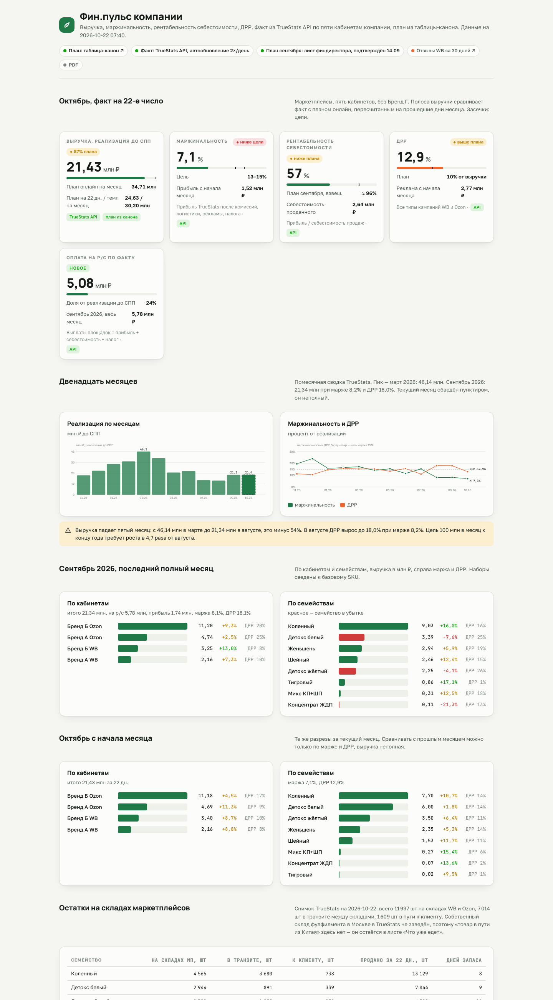

# Фин.пульс: финансовый дашборд продавца на маркетплейсах

> Конвейер «API аналитики → Google-таблица → HTML-дашборд → сайт» для руководителя и финдиректора: выручка, маржинальность, рентабельность себестоимости, ДРР, выплаты на расчётный счёт, остатки и товар в пути. Python stdlib, без фреймворков, обновляется дважды в день по launchd.
>
> *Finance pulse for a marketplace seller: TrueStats API → Google Sheets (canon table) → static HTML dashboard → hosting. Pure Python, no dependencies, runs twice a day.*

На скриншоте настоящие цифры компании с пятью кабинетами на Wildberries, Ozon и Яндекс Маркете; названия брендов заменены.



## Зачем

У команды был план продаж в Google-таблице и факт в сервисе аналитики TrueStats, а сравнивать их приходилось вручную. Фин.пульс каждое утро сам забирает факт, кладёт его в «таблицу-канон» (единый источник для всех), собирает страницу с планом и фактом и выкладывает её на сайт под паролем.

## Что показывает

- **Месяц на сегодня**: выручка до СПП против плана, пересчитанного на прошедшие дни; маржинальность с целью; рентабельность себестоимости; ДРР; выплаты на р/с по факту.
- **Двенадцать месяцев**: столбики реализации и линии маржи и ДРР, автоматический текстовый вывод («выручка падает пятый месяц…»).
- **Последний полный месяц и текущий**: разрезы по кабинетам и по товарным семействам с динамикой и ДРР, убыточные семейства выделены.
- **Остатки**: склады маркетплейсов, транзит, в пути к клиенту, дней запаса по семействам.
- **Товар из Китая**: приехало и остаток к следующему месяцу из листов таблицы, которые ведёт команда.
- **Источники данных**: блок «что подключено, что следующим шагом», чтобы заказчик видел границы автоматизации.

## Как устроено

```
launchd 07:40 и 13:40
  └─ run_finpulse.py
       ├─ truestats_pull.py   TrueStats API → листы TS_факт_SKU, TS_кабинеты, TS_месяцы, TS_остатки, TS_лог
       ├─ onec_pull.py        1С (OData, только GET) → остатки склада фулфилмента
       ├─ build_finpulse.py   JSON-срез + план из Google Sheets → finpulse.html (SVG-графики без JS-библиотек)
       └─ ftp_deploy.py       зеркалирование на хостинг по FTPS (или rsync по SSH)
```

- `truestats_pull.py`: четыре периода (текущий месяц и три полных), 60 запросов в минуту, полная перезапись листов `TS_…`, лог в отдельный лист таблицы.
- `build_finpulse.py`: все расчёты в одном файле, графики рисуются как inline-SVG, страница весит ~50 КБ и открывается без интернета.
- `onec_stage0.py`: разведка опубликованных объектов OData 1С (`$metadata`), пароль не логируется.
- `ftp_deploy.py`: FTPS с переиспользованием TLS-сессии на канале данных (требование vsftpd), зеркалирование с удалением лишнего.
- `md2html.py`: отчёт по отзывам из Markdown в HTML того же стиля.

Секреты лежат вне репозитория: `~/.config/truestats/secrets.env`, `~/.config/finpulse/1c.env`, `~/.config/finpulse/ftp.env`, Google-токен в `~/.config/gdrive-claude/token.json`.

## Запуск

```bash
git clone https://github.com/Vladislav352/finpulse && cd finpulse
cp deploy.env.example deploy.env         # DEPLOY_MODE=ftp|rsync|none, адрес
# вписать SHEET_ID и ACCOUNTS в truestats_pull.py / build_finpulse.py
python3 truestats_pull.py --dry-run      # проверка доступа к API без записи
python3 run_finpulse.py --no-deploy      # собрать finpulse.html локально
```

## Показатели

- Выручка = `realisation` (до СПП). Маржа = `profit / realisation`.
- Рентабельность себестоимости = `profit / costOfSales`.
- ДРР = `advertisingExpenseSum / realisation`, все типы кампаний.
- Выплата на р/с = `totalPaid`; к перечислению = `toTransfer`.

## Автор

Владислав Арсентьев, AI-интегратор. Собрано с Claude Code, сопровождение передано агенту OpenClaw по инструкции в репозитории заказчика.
